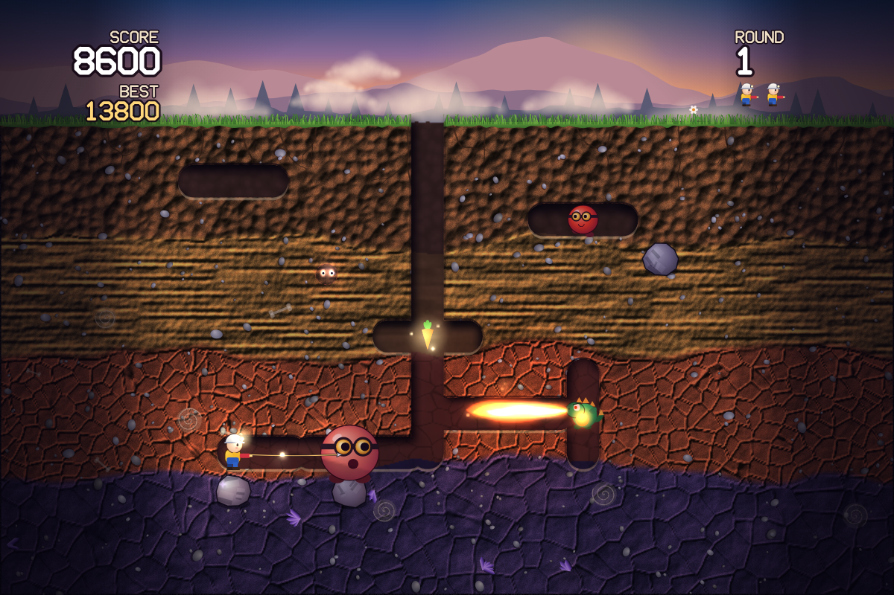
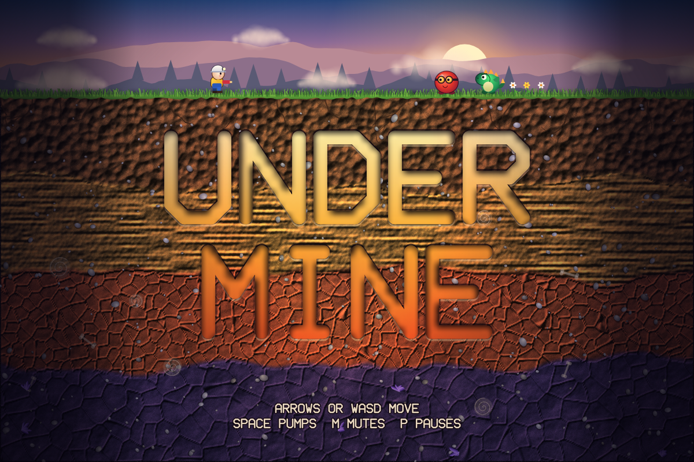
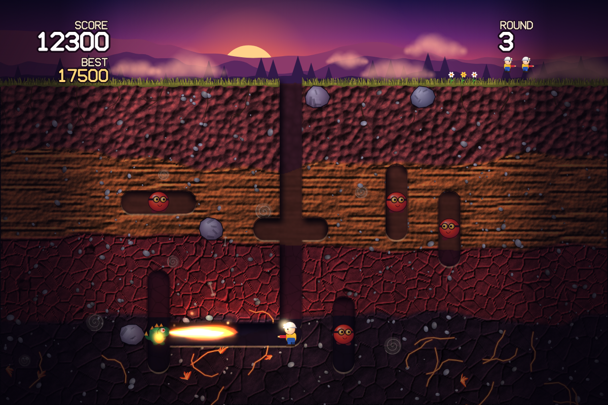
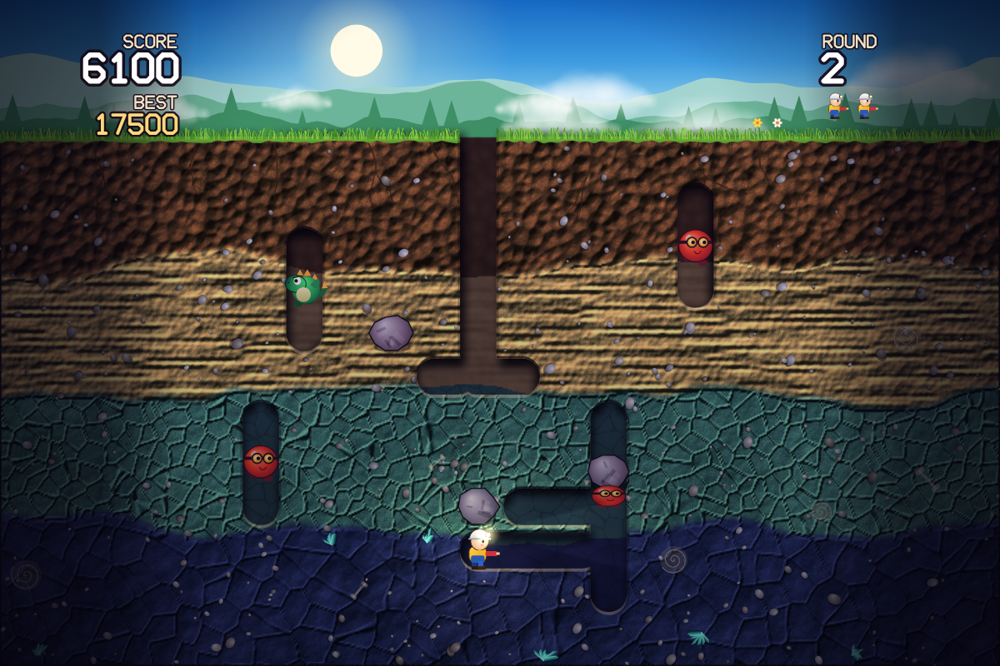
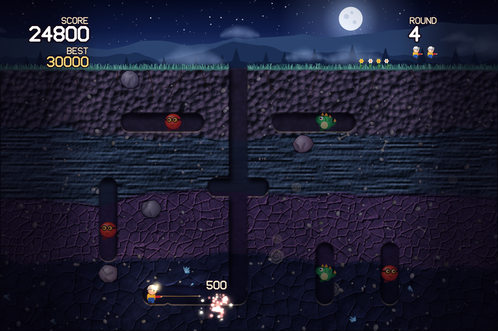
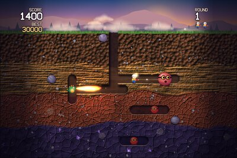
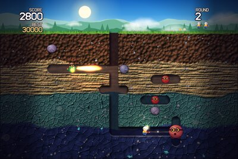
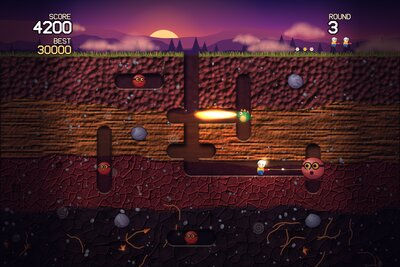
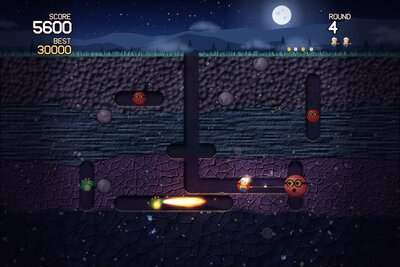

# UNDERMINE

A dig-and-pump arcade game for the browser, in the spirit of the 1982 coin-ops, with modern graphics. Tunnel through the soil, pump up whatever is chasing you, and drop rocks on the rest.

**▶ Play: https://wigy.github.io/undermine/**



| | |
|---|---|
|  |  |
|  |  |

## How to play

| Action | Keyboard | Touch | Gamepad |
|---|---|---|---|
| Move and dig | ← ↑ → ↓ / W A S D | drag on the left side | D-pad or stick |
| Fire and pump | Space / Z / X / Enter (hold to keep pumping) | hold on the right side | A, B or X |
| Pause | P / Esc | | Start |
| Mute | M | | |

Get rid of every enemy to clear the round. Fire the harpoon along a tunnel to hook an enemy, then pump it four times to pop it. If you stop pumping, it deflates and comes after you again. The harpoon can't pass through solid dirt or rocks.

**Enemies**

- **Puff** (red, in goggles): walks the tunnels and drifts through solid dirt towards you, showing only its glowing eyes.
- **Cinder** (green dragon): does the same, and also breathes fire along its row. The flame goes straight through dirt, so watch for its belly glowing just before it fires.

The last enemy left in a round runs for the surface. If it gets away, the round ends and you get no points for it.

**Rocks**

Dig out the dirt under a rock and it wobbles, then falls, crushing anyone below, including you. It waits while you stand directly underneath, so you can lure enemies in before stepping aside. After two rocks have fallen, a bonus vegetable appears in the centre for 10 seconds.

**Scoring**

| Popped in | Soil layer 1 (top) | Layer 2 | Layer 3 | Layer 4 (bottom) |
|---|---|---|---|---|
| Points | 200 | 300 | 400 | 500 |

A Cinder popped from the side scores double.

| Enemies crushed by one rock | 1 | 2 | 3 | 4 | 5 | 6 | 7 | 8 |
|---|---|---|---|---|---|---|---|---|
| Points | 1,000 | 2,500 | 4,000 | 6,000 | 8,000 | 10,000 | 12,000 | 15,000 |

You start with three lives and get an extra one at 10,000 points, at 40,000, and then every 40,000 after that.

## Levels

Click a picture to see it full size. Tunnels and rocks are laid out differently every game. After round 4 the settings repeat with more enemies and rocks, up to 10 enemies and 6 rocks, and enemies get faster and take to the dirt sooner.

<table>
  <tr>
    <td align="center"><a href="docs/screenshots/levels/01-dawn.png"></a><br><b>1. Dawn</b><br>4 enemies, 3 rocks<br>Amethyst at the bottom</td>
    <td align="center"><a href="docs/screenshots/levels/02-noon.png"></a><br><b>2. Noon</b><br>4 enemies, 3 rocks<br>Aquamarine at the bottom</td>
    <td align="center"><a href="docs/screenshots/levels/03-dusk.png"></a><br><b>3. Dusk</b><br>5 enemies, 4 rocks<br>Lava veins at the bottom</td>
    <td align="center"><a href="docs/screenshots/levels/04-night.png"></a><br><b>4. Night</b><br>6 enemies, 4 rocks<br>Ice crystals at the bottom</td>
  </tr>
</table>

## Development

There is nothing to install or build: open `index.html` in a browser. To run the tests, you need Node.js 24 or later.

```bash
npm test                                                  # unit tests for the game rules
NODE_PATH=$(npm root -g) node scripts/capture-screenshots.js   # regenerate the README images
```

The screenshot script needs Playwright installed globally, Chrome and ImageMagick. It stages each scene, then captures what the real renderer draws.

The game is plain JavaScript and Canvas 2D with no runtime dependencies. All the graphics are painted in code and all the sound is synthesized with WebAudio, so there are no asset files. The rules live in `src/sim.js`, which doesn't touch the browser, and drawing lives in `src/render.js`. GitHub Pages serves the `main` branch directly, so every push to `main` goes live.
